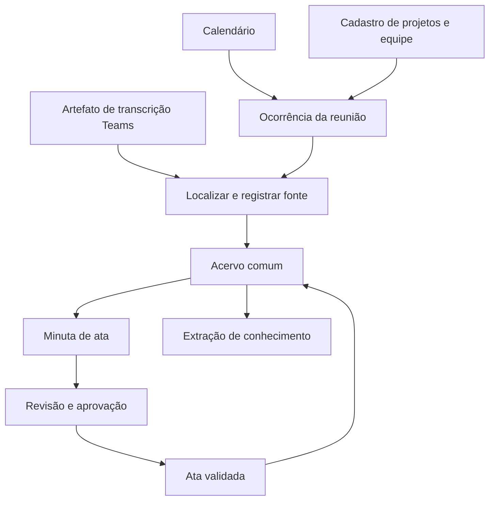

# Alimentação multifuente

**Estado:** proposta de desenho, 14/11/2026. WhatsApp possui implementação experimental; demais módulos em descoberta.

## Princípio

Um documento ou registro deve ser recuperável independentemente da aplicação que o consumirá. Registrar a origem e a localização autorizada, preservar identidade, data, versão e relações. Não copiar automaticamente todas as fontes para um único local: quando o original já está acessível, um índice ou referência pode ser suficiente; quando necessário, produzir uma projeção ou cópia controlada no acervo comum.

## Módulos

| Módulo | Origem | Artefato esperado | Questões em aberto |
| --- | --- | --- | --- |
| WhatsApp | Sessão vinculada e histórico | Markdown por grupo/dia | Backfill, mutações, automação |
| Transcrições | Reuniões Teams, artefatos existentes | Registro da transcrição e referência/cópia autorizada | Local real, API/acesso, formatos, versão, consentimento e retenção |
| Atas | Atas existentes ou minuta derivada de reunião | Ata original, minuta ou versão validada | Autoridade, aprovação, relação com transcrição |
| E-mails | Contas, pastas e caixas autorizadas | Mensagem, thread, anexos ou referência | Seleção, deduplicação, classificação, vínculo e sigilo |
| Documentos e anotações | SharePoint e outros repositórios autorizados | Documento/versão e contexto | Fonte canônica, alterações, vínculo e acesso |

## Reuniões: fluxo de referência

Agenda registra o previsto; ocorrência registra o que se sabe que aconteceu. Uma transcrição pode chegar depois, não existir ou cobrir apenas parte da reunião. Ata não equivale a transcrição; uma minuta derivada de IA não é ata aprovada.

## Contrato mínimo a desenhar

ID da fonte e versão; tipo; sistema e localização original; data de origem e aquisição; vínculos com reunião/projetos; permissões; estado de processamento; integridade e histórico de alterações. Campos e tecnologia ainda não definidos. Distinguir identidade de origem de identidade de representação.

## SharePoint: organização a estudar

Um ponto comum de acesso às fontes autorizadas, possivelmente com índices e áreas por tipo. Não criar pastas físicas ou mover documentos antes de mapear a localização real, responsabilidade, política de acesso e necessidade de duplicação. A estrutura WhatsApp existente permanece inalterada.

## Relações

- [Contexto e reuniões](../contexto/README.md)
- [Consolidação](../conhecimento/README.md)
- [Integração WhatsApp](../integracoes/watchtower-whatsapp.md)
- [Backlog](../backlog.md)
