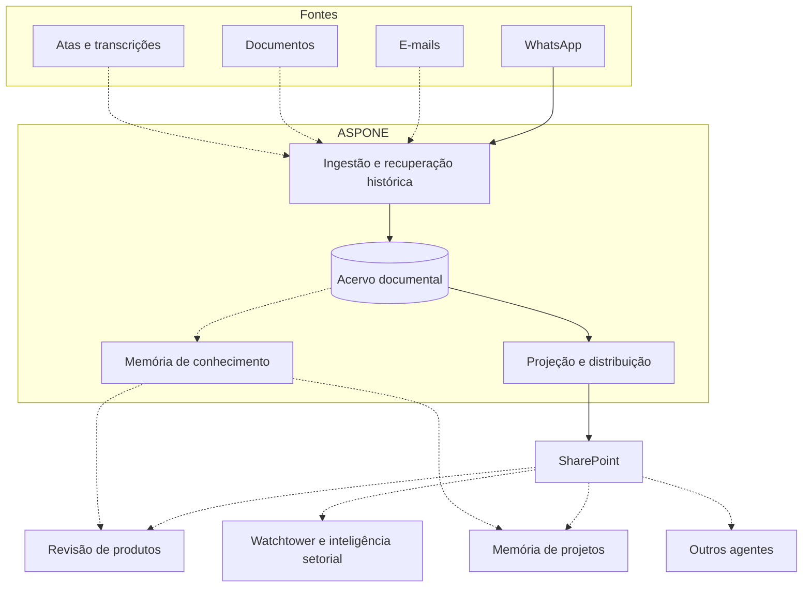
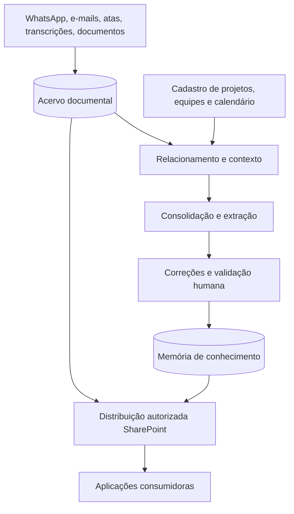

# Arquitetura do ASPONE

O README conceitual estabelece duas capacidades: acervo documental e memória de conhecimento. A arquitetura deve preservar a independência entre infraestrutura e aplicações. A primeira integração experimental usa a stack conhecida como Watchtower WhatsApp; isso não determina a hierarquia definitiva entre produtos.

Linhas contínuas representam o fluxo já demonstrado para WhatsApp; linhas tracejadas são possibilidades futuras. SharePoint é um destino de distribuição, não a implementação da memória de conhecimento.

## Responsabilidades

- Aquisição: receber eventos e recuperar histórico com controle de origem e duplicidade.
- Acervo: persistir os registros e permitir reconstrução de representações.
- Distribuição: preparar documentos autorizados, com controle de atualização e integridade.
- Memória: relacionar fontes, entidades, afirmações e suas revisões; ainda em concepção.
- Aplicações: interpretar e utilizar o acervo de acordo com seu objetivo, sem modificar a fonte original.

Uma conversa e um projeto são entidades distintas. A associação semântica poderá ser muitos-para-muitos; não deve ser inferida automaticamente pelo nome nem imposta à estrutura da fonte.

## Decisões de referência

A separação entre fonte, projeção e interpretação é uma regra de arquitetura. A escolha de WAHA, PostgreSQL, Markdown e rclone descreve a primeira implementação, não uma obrigação para todas as futuras fontes. O contrato de identidade estável entre as projeções e os consumidores ainda requer definição.

## Ampliação conceitual: contexto e consolidação

Este segundo diagrama descreve a visão pretendida, não estado implantado. Os cadastros compartilhados relacionam fontes a eventos e projetos; não concedem permissões nem determinam automaticamente a validade de uma afirmação. A memória de conhecimento distingue evidência, interpretação, decisão e vigência. SharePoint poderá distribuir projeções autorizadas de ambas as capacidades; a forma de armazenamento da memória ainda será definida.

## Relações

- [Negócio](negocio.md)
- [Integração WhatsApp](integracoes/watchtower-whatsapp.md)
- [Evolução](evolucao.md)
- [To-do list](backlog.md)
- [Alimentação multifuente](alimentacao/README.md)
- [Contexto compartilhado](contexto/README.md)
- [Consolidação e correção](conhecimento/README.md)
- [Camada de Conhecimento e Verdade](conhecimento/camada-conhecimento-verdade.md) — definição conceitual e entendimento das três responsabilidades
