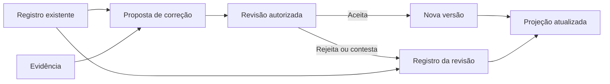

# Consolidação, correções e conhecimento vigente

**Estado:** proposta de processo, 14/11/2026. Não é especificação definitiva nem mecanismo já implementado.

## Problema

Acumular fontes não basta. O usuário precisa saber o que está valendo, por que está valendo, em qual escopo, quem confirmou, quais questões continuam abertas e quais entendimentos foram substituídos. Uma reunião, e-mail ou anotação pode conter uma proposta, uma dúvida ou uma decisão; isso não é determinado apenas pela existência do texto.

## Separação das camadas

1. Evidência original: documento, mensagem, ata ou transcrição, com origem e versão.
2. Extração/interpretação: informação identificada por IA ou pessoa, com referência à evidência e grau de revisão.
3. Conhecimento validado: registro autorizado de entendimento, regra, premissa, decisão ou pendência, com escopo e histórico.
4. Projeção de consulta: síntese ou arquivo derivado do conhecimento, distribuído aos consumidores autorizados.

## Tipos e estados candidatos

| Tipo | Sentido |
| --- | --- |
| Decisão | Escolha registrada, com autoridade e escopo identificáveis |
| Regra | Critério aplicável sob condições definidas |
| Premissa | Hipótese adotada para análise ou trabalho |
| Pendência | Questão ou ação não resolvida, com responsável quando conhecido |
| Anotação | Observação ou registro de interpretação, não necessariamente validado |
| Dúvida/proposta | Questão ou alternativa em discussão |

Estados propostos: extraído, em revisão, validado, substituído, rejeitado, contestado e retirado. Vigência temporal e escopo devem ser atributos próprios, não simples consequência de ser o documento mais recente. A transição para validado depende de autoridade e evidência; substituições podem ser parciais. Estes estados serão refinados com casos de uso.

## Correção de anotação

Registrar quem propôs e validou, quando, o motivo, o registro afetado, a evidência, a alteração e a vigência. Preservar o anterior e a relação de substituição; não editar silenciosamente a fonte. Uma correção deve poder ser corrigida. A interface desejada deve permitir registrar e revisar correções sem depender de edição manual de arquivos Markdown. A forma de armazenamento permanece em aberto.

## Artefatos de consolidação a estudar

- Decisões: registro, autoridade, contexto, alternativas e evidências.
- Regras e premissas vigentes: aplicabilidade, versão, exceções e vínculos.
- Pendências e responsabilidades: situação, ação, responsável e prazo quando conhecido.
- Síntese de projeto ou assunto: visão derivada, datada e com referências.
- Histórico de mudanças: o que mudou, por quem, por que e quando.
- Conflitos e dúvidas: divergências identificadas e ainda não resolvidas.

Não presumir um arquivo único como fonte canônica. Avaliar formato e local: arquivos de consulta no SharePoint, armazenamento estruturado interno, ou combinação, conforme acesso, versionamento e rastreabilidade. A fonte original continua preservada; as projeções devem ser reconstruíveis. Não criar diretórios reais ou políticas de autoridade nesta fase.

## Questões de processo

Quem pode declarar uma decisão vigente? Como registrar divergência entre reunião, e-mail e documento oficial? Como tratar decisão revogada ou parcialmente alterada? Como indicar que uma fonte foi corrigida ou deixou de estar acessível? Como evitar que consumidores reutilizem informação substituída? Quais artefatos são consultados e onde? Validar com exemplos fictícios e, depois, casos autorizados.

## Relações

- [Arquitetura](../arquitetura.md)
- [Contexto compartilhado](../contexto/README.md)
- [Alimentação](../alimentacao/README.md)
- [Backlog](../backlog.md)
