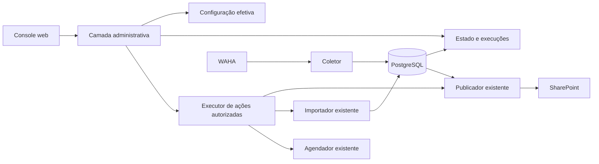

# ASPONE / Watchtower — Console de configuração e operação

**Status:** proposta para exploração, não implantação. Nenhuma biblioteca ou framework aprovado.

## Objetivo e contexto

Construir uma interface web administrativa sobre a integração WhatsApp existente, para administrar grupos, publicação, horários, execuções e, posteriormente, histórico e arquivos. Reutilizar WAHA/GOWS, coletor, PostgreSQL, geradores Markdown, publicador via rclone e agendador existente. Não duplicar coleta, persistência ou publicação. O administrador inicial opera em ambiente LAB privado; consumidores SharePoint não precisam acessar o console.

Consultar [integração WhatsApp](../integracoes/watchtower-whatsapp.md), [módulo existente](../../modules/whatsapp/README.md) e [backlog](../backlog.md). Confirmar estado efetivo no ambiente autorizado; documentação não prova runtime. Configurações privadas, nomes de grupos, caminhos do ambiente, credenciais e dados reais permanecem fora do repositório público. A periodicidade aprovada é diária às 03h00, America/Sao_Paulo; autoria de exibição autorizada para os grupos selecionados; anexos excluídos; datas de início existentes preservadas. Confirmar esses parâmetros na configuração efetiva.

## Arquitetura conceitual

Avaliar interface existente antes de criar outra. Comparar aplicação Python integrada, páginas server-rendered e frontend separado somente se justificado. Não adicionar banco de mensagens, orquestrador ou infraestrutura de filas sem necessidade. Coleta e agendamento continuam independentes da disponibilidade do console.

## Pesquisa de bibliotecas e templates (UI-01)

Priorizar componentes maduros, templates administrativos completos e bibliotecas open source, não codificar elementos visuais do zero. Lista inicial não exaustiva: Streamlit, Dash, NiceGUI, Tabler, shadcn/ui, Apache ECharts, Plotly, Chart.js e Recharts. Investigar outras alternativas e registros na Wiki autorizada. Avaliar licença, maturidade, manutenção, integração Python, formulários, tabelas filtráveis, navegação, indicadores, gráficos, notificações, autenticação, consumo de recursos, esforço e reutilização em outros módulos. Apresentar links oficiais, exemplos visuais, comparativo e recomendação fundamentada. Não implementar antes de aprovar arquitetura.

## Telas e requisitos

### Visão geral (MVP)

- Saúde observada de WAHA, coletor, PostgreSQL e publicador, timestamp da verificação e estado desconhecido/desatualizado quando necessário.
- Grupos descobertos, selecionados e habilitados (contagens distintas); mensagens, MD locais e publicados (não confundir); histórico recuperado e retenções.
- Último evento, última publicação verificada, próxima execução calculada do agendador efetivo, resultado e alertas. Atalhos para grupos, simulação e execuções. Publicar agora exige confirmação.
- Não exibir conteúdo das conversas no painel inicial.

### Grupos (MVP)

- Tabela pesquisável e filtrável: nome, categoria, coleta observada, seleção, publicação habilitada, autoria, anexos, data inicial de publicação, destino, cobertura histórica, última atividade e ações.
- Identidade estável por sessão e ID de grupo, não pelo nome. Grupo não equivale automaticamente a projeto. Separar descoberta, captura, seleção e publicação. Não habilitar automaticamente grupos novos.
- Detalhe: primeira/última data observada, fontes WAHA/exportação, registros por período, retenções, publicação e mudanças; IDs técnicos recolhidos, sem telefones na listagem.
- Edição: mostrar diferenças antes/depois, validar datas e destinos, confirmar explicitamente novos grupos ou ampliação de escopo. Desabilitar publicação futura não apaga arquivos anteriores. Não alterar pareamento/coleta pela tela. Persistir na fonte efetiva.

### Sincronização (MVP)

- Chave global de publicação independente da coleta. Frequência inicialmente diária e horário editável HH:mm, timezone explícito.
- Exibir configuração real do agendador, próxima execução, último sucesso/falha, discrepâncias e estado desconhecido.
- Destino autorizado, inicialmente somente leitura, sem credenciais; conectividade verificável sem revelar segredos.
- Simular (sem upload), publicar agora, salvar horário, suspender/reativar publicação. Usar o mesmo publicador manual e automático; nunca publicar prévia não autorizada.
- Alterar apenas a entrada da aplicação no agendador, preservar tarefas alheias, impedir duplicidade.
- Gerar MD diário apenas se houver mensagens, atualizar dias corrigidos, transferir por checksum e verificar remotamente. Não usar sync destrutivo nem exclusão automática. Versões antigas podem persistir.

### Execuções (MVP)

- Lista de execuções manuais/automáticas: tipo, início/fim, duração, estado, grupos, mensagens, arquivos preparados/verificados, operador/origem, erros sanitizados.
- Estados: pendente, executando, concluída e verificada, falhou, bloqueada, parcial, desconhecida. Disparo não equivale a sucesso; não inventar métricas ausentes nos logs.
- Detalhes e logs limitados, progresso disponível, identificador único. Repetir quando seguro e confirmado.
- Ações longas executadas no servidor, job ID e consulta de estado; fechamento do navegador não interrompe job. Reutilizar locks e impedir operações concorrentes incompatíveis. Avaliar registro simples persistente, sem duplicar banco de mensagens.

### Histórico e ZIPs (fase 2)

- Inventário autorizado: grupo, arquivo, tamanho, hash, origem, recebimento, download, importação, elegíveis/importados/retidos e sobreposição.
- Buscar exportações, processar pendentes, reprocessar e ver relatório usando importador existente. Um ZIP inteiro por grupo; sem limite mensal artificial. Download externo controlado, verificação de hash, cache e originais preservados, limites de arquivo.
- Ler TXT, preservar VCF auxiliar sem extrair; não baixar demais mídias. Mapear explicitamente grupo autorizado; reexportações diferentes e ambiguidades aguardam reconciliação.
- Importar localmente não é publicar. Ampliação histórica exige prévia, autorização, deduplicação e validação de mutações. Não reconfigurar sessão nem forçar sincronização WAHA. Não assumir completude do histórico.

### Arquivos e processamento (futuro)

Políticas por origem/tipo, cache, staging, originais, derivados, quarentena, classificação pessoal/profissional, armazenamento e backup. Áudio, transcrição, OCR, embeddings e workers distribuídos seguem backlog WH-04 a WH-11; não construir nesta fase.

### Configuração (MVP reduzido)

Ambiente, versão, timezone, parâmetros efetivos, fonte de verdade e auditoria: autor, data, anterior/novo, motivo, resultado. Segredos somente configurado/ausente. Não editar OAuth, chaves ou pareamento nesta versão. Exportação sanitizada e backup privado antes de alterações.

## Contratos propostos (não APIs existentes)

Exemplos a refinar na exploração: GET status/grupos/detalhe/configuração/execuções; PATCH grupo e horário; POST simulação e publicação; GET status de job. Futuramente inventário e processamento de exportações. Aplicação server-rendered pode cumprir os mesmos contratos sem API separada. Validar tipos, autorização e versão concorrente; ações fixas e consultas parametrizadas. Não aceitar comandos ou caminhos arbitrários.

## Segurança e integridade

- Rede privada, autenticação administrativa, autorização no backend, proteção CSRF e sessões seguras. Não expor publicamente nem presumir que rede privada substitui autenticação.
- Não entregar Docker socket, sudo irrestrito, shell arbitrário ou credenciais à UI. Avaliar executor local com permissões mínimas.
- Fonte de verdade: configuração de grupos/publicação existente, agendador real, banco de mensagens, logs/registro de jobs. Evitar duplicar configurações. Escrita atômica, lock, backup, validação do schema, controle de versão, preservar campos e tarefas existentes.
- Preservar autorização, nomes de exibição e período aprovados; identidade de exibição não equivale a identidade verificada. Não expor IDs de remetentes, anexos ou conteúdo revogado indevidamente. Escapar conteúdo.
- Não reiniciar WAHA por alterações no console; instalação, migração ou implantação dependem de aprovação. Compose separado e reconstruível, persistência explícita, restart unless-stopped, README, rede/portas e rollback. Dados reais e segredos fora do GitHub.

## Etapas

1. **Exploração:** ler repositório e Wiki autorizada; inventariar componentes e interfaces existentes; confirmar runtime quando houver acesso; concluir pesquisa de bibliotecas; propor arquitetura, wireframes, contratos, recursos, permissões, testes e rollback. Parar para aprovação antes de implementar.
2. **Somente leitura:** prototipar com fixtures sintéticas; integrar adaptadores para grupos, status, horário e execuções; validar números.
3. **Configuração e operações:** edição com confirmação, backup, lock, auditoria; simulação e publicação manual; testes de concorrência e falhas.
4. **Histórico:** integrar importadores, relatórios e reconciliação; publicação separada.
5. **Implantação LAB:** stack aprovada, acesso privado, teste de recursos, segurança, persistência e rollback. Não promover ao CORE nesta etapa.

## Aceitação do MVP

- Grupos e configurações reais, distinção entre captura/seleção/publicação, nenhum grupo novo publicado implicitamente.
- Nomes e datas autorizados preservados; próxima execução fiel ao scheduler e timezone.
- Simulação sem upload; publicação manual e automática usam mesmo fluxo; correções e novos MDs sem exclusões destrutivas.
- Jobs persistem ao fechar navegador, cliques duplicados não geram execução concorrente, falhas sem falso sucesso.
- Configuração inválida/conflitante rejeitada; restauração testada; coleta não interrompida; autenticação e autorização testadas.
- Testes unitários, integração sintética, smoke test no LAB, documentação e evidências reproduzíveis.

## Entregáveis da exploração

- `docs/console/exploracao.md`: arquitetura observada, pesquisa de bibliotecas/templates, alternativas e recomendação.
- `docs/console/especificacao.md`: refinamento de requisitos, wireframes, contratos, estados e riscos.
- `docs/console/plano-implementacao.md`: fases, estrutura, testes, implantação e rollback.

Registrar decisões e pendências no backlog. Manter o conteúdo público sanitizado e registrar detalhes efetivos somente na Wiki privada. Não escolher tecnologia nem iniciar implementação antes da discussão com o operador.
