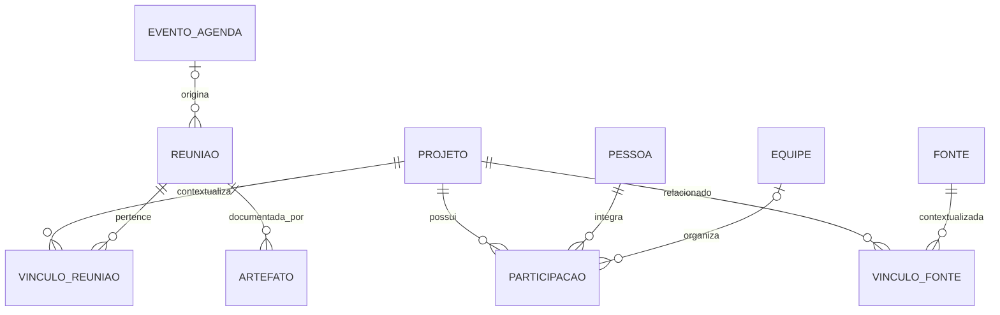

# Contexto compartilhado: projetos, equipes, calendário e reuniões

**Estado:** concepção, 14/11/2026. Não há cadastro ou calendário implantado por este documento.

## Objetivo

Permitir que uma fonte seja relacionada a um acontecimento, projeto ou equipe sem depender de seu nome de arquivo ou pasta. Cadastro comum fornece identidade e contexto às aplicações; não substitui sistemas institucionais existentes nem pressupõe um único banco.

## Modelo conceitual proposto

O desenho é lógico, não esquema físico definitivo. Uma reunião pode ter mais de um projeto; um evento recorrente pode produzir ocorrências distintas; reuniões sem evento identificado precisam de fluxo próprio. Uma conversa pode se relacionar com vários projetos.

| Entidade | Informação candidata |
| --- | --- |
| Projeto | ID estável, nome, descrição, situação, período, referências |
| Equipe | Identidade, finalidade, referências aos cadastros existentes |
| Pessoa e participação | Identidade, papel, projeto, equipe quando aplicável, vigência da participação |
| Evento de agenda | ID na origem, título, início/fim, organizador, convidados, recorrência, situação |
| Ocorrência de reunião | ID, evento relacionado quando conhecido, realização confirmada ou não, data efetiva, participantes conhecidos |
| Artefato de reunião | Tipo (transcrição, ata, gravação, anexo), origem, versão, vínculo, disponibilidade |
| Vínculo de fonte | Fonte, projeto/reunião, motivo, método, autor, confirmação e vigência |

## Calendário comum

Avaliar se o objetivo é atendido por agenda de equipe compartilhada, por uma visão federada das agendas autorizadas ou por ambas. O calendário deve permitir identificar reuniões previstas e ligar os artefatos posteriores, não copiar toda agenda pessoal. O local de registro, o responsável, as permissões, a recorrência e os critérios de confirmação devem ser definidos antes da implementação.

## Regras de relacionamento

- Não usar título ou nome como chave única.
- Não confundir reunião agendada com realizada; não inferir presença só por convite.
- Manter vínculo com a origem da agenda e da transcrição; associação automática incerta deve ser revisável.
- Identidade do projeto não depende de WhatsApp, pasta, reunião ou equipe.
- Vínculo semântico não concede acesso a uma fonte; autorização continua independente.

## Relações

- [Alimentação](../alimentacao/README.md)
- [Conhecimento](../conhecimento/README.md)
- [Backlog](../backlog.md)
