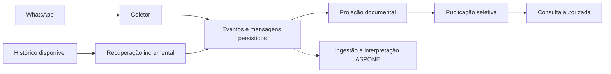

# Ingestão de mensagens WhatsApp — integração ASPONE / Watchtower

## Contexto

O ASPONE reúne, preserva e relaciona informações de diferentes fontes para constituir um acervo documental e uma memória de conhecimento. A integração WhatsApp é uma experiência concreta de ingestão de fontes, desenvolvida no contexto do Watchtower. Ela não define, por si só, a arquitetura integral do ASPONE.

## Escopo

- Coletar mensagens e eventos de conversas selecionadas.
- Preservar sua origem, identidade, data e histórico de alterações.
- Recuperar progressivamente o histórico disponível.
- Gerar documentos de consulta derivados da fonte.
- Disponibilizar somente conteúdo autorizado em um destino de consulta.
- Permitir processamento posterior por aplicações de gestão do conhecimento.

## Fluxo experimental

A coleta corrente e a recuperação histórica são operações complementares. A persistência dos eventos permite tratar edições e revogações sem confundir o registro original com sua representação atual. A publicação é uma projeção seletiva, não uma cópia integral do banco.

## Organização das fontes

Uma conversa WhatsApp e um projeto são entidades distintas. Os documentos devem preservar a identidade da conversa. A associação a um ou mais projetos pode ser registrada separadamente, na camada de conhecimento, sem alterar a estrutura da fonte.

A organização experimental utiliza um arquivo Markdown por conversa e dia. A escolha dos formatos de armazenamento e consulta não impede outras projeções futuras.

## Proveniência e atualizações

A ingestão deve permitir rastrear a origem de cada registro, distinguir mensagens recebidas em tempo real das importadas historicamente e evitar duplicidades. Edições, revogações e correções precisam de tratamento explícito. A disponibilidade do histórico depende da fonte; não se presume completude.

O conteúdo original, as inferências produzidas por IA e as validações humanas devem permanecer distinguíveis. A extração de decisões, premissas e pendências é uma etapa posterior, não equivalente à ingestão.

## Segurança e limites

A publicação exige seleção e autorização de fonte, finalidade, período e público. A remoção de identificadores técnicos não torna o texto anônimo. Revogar ou corrigir um registro na origem não elimina necessariamente versões, cópias e downloads anteriores no destino.

Dados de conversas, credenciais, identificadores pessoais e configuração de ambientes reais não integram este documento nem devem ser incluídos no repositório público.

## Estado

O fluxo é experimental. A coleta, a projeção em Markdown, a publicação seletiva e um piloto de recuperação histórica já foram testados em ambiente de desenvolvimento. A generalização da recuperação histórica, a automação periódica e a integração com a memória de conhecimento permanecem em desenvolvimento.

## Relação com o ASPONE

Esta integração materializa uma das possíveis capacidades de aquisição de fontes. O contrato entre ingestão, acervo documental e memória de conhecimento ainda será definido de forma progressiva. Não implica que o Watchtower seja subordinado ao ASPONE ou vice-versa: a relação entre as aplicações e a infraestrutura deve ser explicitada na arquitetura futura.

[Voltar ao README do ASPONE](../../README.md)
