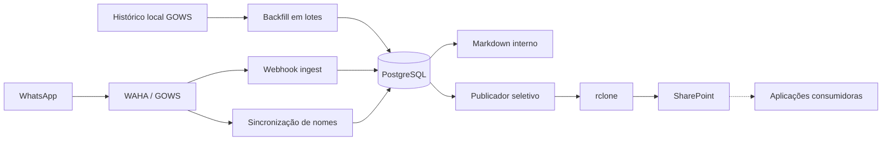

# Integração WhatsApp — ASPONE / Watchtower

Primeira implementação concreta de aquisição de fontes. A stack experimental recebe eventos WAHA, mantém PostgreSQL e produz duas projeções Markdown: uma interna, com identidade técnica, e outra destinada à consulta autorizada.

## Escopo validado em laboratório

Recepção contínua, armazenamento de eventos, deduplicação, edições e revogações, projeção diária, seleção de grupos, publicação manual verificada e piloto de recuperação histórica. Não se presume histórico completo. O agendamento de publicação, a proteção recorrente comprovada e a generalização do backfill ainda são pendências da implantação examinada em 14/11/2026.

## Documentação do módulo

- [Implantação técnica](whatsapp/implantacao.md)
- [Modelo de dados e proveniência](whatsapp/dados.md)
- [Publicação e consumo no SharePoint](whatsapp/sharepoint.md)
- [Operação, backup e restauração](whatsapp/operacao.md)
- [Código e inventário de scripts](../../modules/whatsapp/README.md)

## Relações

- [Arquitetura](../arquitetura.md)
- [Wiki](../README.md)
