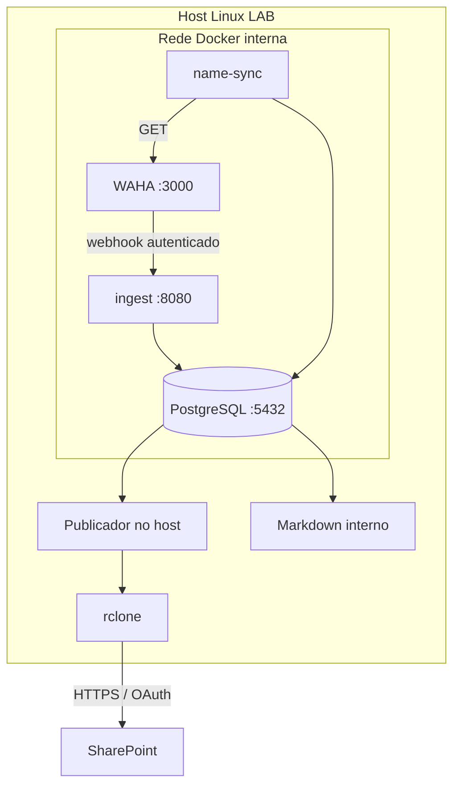

# Implantação técnica da integração WhatsApp

## Topologia de referência

O piloto roda em um host Linux de laboratório. Docker Compose administra WAHA (motor GOWS), ingest Python, PostgreSQL 17 e name-sync. O rclone 1.76.0 roda no host como utilitário, não como container permanente. Esses números refletem o ambiente examinado em 14/11/2026, não requisitos universais ou versões mais recentes.



Apenas o painel WAHA deve ser disponibilizado à administração restrita. PostgreSQL e ingest não precisam publicar portas no host. A equipe não acessa a rede privada do servidor. Não expor o painel ou o banco à internet.

## WAHA

Usar sessão vinculada via QR e motor GOWS. Configurar webhook para o endpoint /webhook do ingest, com cabeçalho X-Watchtower-Token e eventos de mensagem, edição e revogação; a API key usada por name-sync é mantida em arquivo secreto. Configurar armazenamento persistente de sessão e cache separados. A sessão e a chave de API não podem ser publicadas. WAHA é um cliente não oficial; não garante disponibilidade, completude ou ausência de restrições pelo WhatsApp.

A configuração experimental solicita janela de 30 dias, limite inicial de 100 mensagens por conversa, 128 MB e sincronização completa desabilitada; esses parâmetros foram registrados no diagnóstico de recuperação histórica, não são promessa de histórico recuperável. Não alterar pareamento sem avaliar risco e preservar o estado anterior.

## Ingest e PostgreSQL

Variáveis necessárias ao coletor: DATABASE_URL e INGEST_TOKEN. MARKDOWN_ROOT é opcional, com padrão /data/markdown. O Dockerfile versionado usa Python 3.12 e psycopg 3. O banco deve ter volume persistente e credenciais próprias. O coletor recebe webhooks; não envia mensagens. O serviço name-sync consulta a API via GET e roda, no piloto, a cada 900 segundos. Ele usa WAHA_BASE_URL e WAHA_API_KEY_FILE.

## Publicador e rclone

Um catálogo privado define sessão, ID da conversa, categoria, destino, autorização, data inicial, inclusão de remetente e interruptores de publicação. A rotina usa snapshot PostgreSQL somente leitura, valida mutações, gera Markdown temporário, executa rclone copy e confere conteúdo remoto com rclone check --one-way --download. Lock impede execuções concorrentes. Não usar a árvore interna de Markdown como origem direta de compartilhamento.

Configurar rclone via `rclone config`, backend OneDrive, autenticação Microsoft 365, site SharePoint por URL, seleção da biblioteca de documentos. Configuração real com permissões restritas. Exemplo de verificação, usando valores fictícios:

```bash
rclone lsf 'aspone-sharepoint:General/Acervo'
rclone copyto README.md 'aspone-sharepoint:General/Acervo/README.md' --immutable
```

O exemplo não concede permissões e não substitui o catálogo de grupos. Nunca executar copy da raiz de mensagens sem seleção explícita.

## Persistência e reconstrução

Preservar definição Compose, código, volume PostgreSQL, sessão WAHA, configuração privada e histórico operacional. Markdown é derivado; backups e credenciais seguem política própria. A configuração exata do ambiente, incluindo caminhos, destinos e detalhes de rede, pertence ao inventário privado.

## Relações

- [Dados](dados.md)
- [Operação](operacao.md)
- [Código](../../../modules/whatsapp/README.md)
