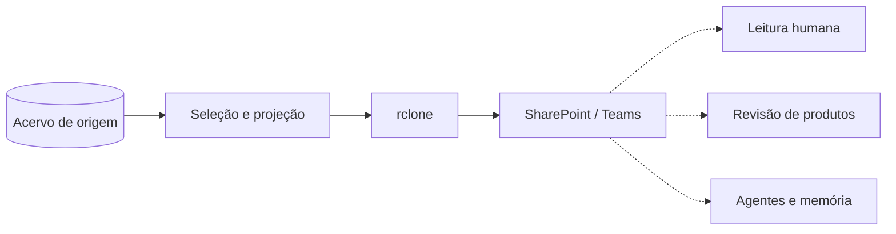

# Distribuição e consumo do acervo no SharePoint

## Finalidade

A publicação torna a fonte acessível às pessoas e sistemas autorizados por Microsoft 365, sem necessidade de acesso ao servidor, WAHA, PostgreSQL ou Tailscale. A mesma fonte pode servir a revisão de produtos, memória de projetos, inteligência setorial e outras aplicações. A conexão efetiva desses sistemas ainda precisa ser implementada.



## Estrutura de publicação

```text
Acervo/
├── README.md
├── 10_Conhecimento/
│   └── Grupo de notícias/
│       └── AAAA-MM-DD.md
└── 20_Projetos/
    └── Nome original do grupo WhatsApp/
        └── AAAA-MM-DD.md
```

Em 20_Projetos, cada pasta é uma conversa, não uma entidade projeto. Preservar nomes originais, ajustando somente caracteres incompatíveis. O catálogo mantém a identidade técnica e a associação ao caminho; não inferir o projeto por ele. Os caminhos de conhecimento do piloto são normalizados com sufixo identificador. Não duplicar conversas em várias pastas para representar projetos distintos.

## Uso esperado

Ler diretamente os arquivos ou disponibilizá-los a um sistema com permissões próprias. O arquivo diário pode mudar por mensagens tardias ou correções: consumidores precisam detectar atualização, reprocessar a versão alterada e manter proveniência. Não usar o nome de arquivo como prova de que o conteúdo é imutável. Uma política de identidade, manifesto de publicação e versionamento entre consumidores está em evolução.

O texto pode conter informações pessoais e confidenciais, mesmo sem IDs técnicos. Acesso e retenção devem ser definidos por fonte e público. Pastas diferentes não garantem ACLs diferentes. Desabilitar a publicação não apaga versões anteriores ou cópias. Usar somente bibliotecas autorizadas, sem links públicos.

## Situação

A transferência manual de um conjunto autorizado de arquivos e a comparação por download foram comprovadas. Atualização horária é uma proposta, não um agendamento já implantado. O destino corporativo específico permanece na documentação privada.

## Relações

- [Negócio](../../negocio.md)
- [Dados](dados.md)
- [Operação](operacao.md)
